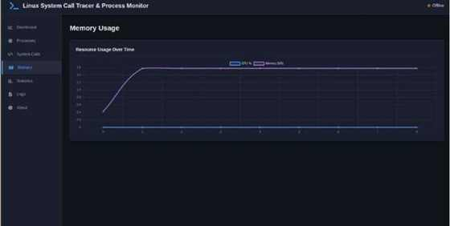
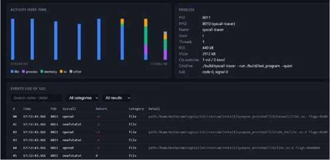
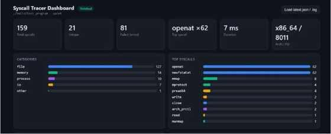

# Linux System Call Tracer & Process Monitor

A Linux systems-programming micro project for observing how applications interact with the kernel. The tracer uses `ptrace()` to record system-call entry and exit events, reads process information from `/proc`, writes timestamped logs and a JSON snapshot, and presents the captured data in a Flask dashboard.

> **Project context:** This README is based on the *Linux System Call Tracer and Process Monitor* micro-project report (Operating Systems, 2026–2027, odd semester). The screenshots and metrics below are from the sample run documented in that report; they are not benchmarks for every program or machine.

## Dashboard Preview

### Resource usage over time



The sample graph shows memory rising from approximately 0.4 MB to approximately 1.6 MB, then remaining steady. CPU usage appears near 0% for this very short run. The dashboard's status is **Offline** because the captured session had already finished and the interface was showing the saved snapshot.

### System-call activity, process information, and events



This view combines a category-coloured activity chart, a process-information panel, and a filterable event table. The report notes that the table displays the most recent 120 events, while summary counters include the whole session.

### System-call statistics



The dashboard summarizes total and unique calls, failed calls, the most frequent syscall, duration, architecture, category counts, and the most frequent syscall names.

## Sample Results From the Report

The following values belong to the report's sample execution of `./build/test_program --quiet` on `x86_64` (PID `8011`). Results may differ with another target program, kernel, architecture, or runtime environment.

| Metric | Reported result |
|---|---:|
| Total system calls | 159 |
| Unique system calls | 21 |
| Calls returning errors | 81 |
| Most frequent system call | `openat` (62 calls) |
| Reported duration | 7 ms |
| Architecture | `x86_64` |
| File category | 127 |
| Memory category | 14 |
| Process category | 10 |
| I/O category | 7 |
| Other category | 1 |

`openat` and `newfstatat` each appeared 62 times. The report explains that many negative results were `ENOENT` (`-2`) responses while the dynamic loader searched several library paths; the test process ultimately exited with code 0. A failed syscall in this context does not by itself mean that the program crashed or failed.

## How It Works

1. **Launch or attach:** The tracer launches a target using `fork()`, `PTRACE_TRACEME`, and `execvp()`/`execve`, or attaches to a process by PID.
2. **Trace system calls:** `PTRACE_SYSCALL` causes stops at syscall entry and exit. `waitpid()` collects the stops, and `PTRACE_GET_SYSCALL_INFO` obtains syscall numbers, entry arguments, exit return values, and error information.
3. **Monitor the process:** The program reads `/proc/<PID>/stat`, `/proc/<PID>/status`, and `/proc/<PID>/cmdline` for process state, parent PID, thread count, CPU ticks, virtual memory, RSS, context switches, and command line.
4. **Categorize and count:** Calls are mapped to names and grouped into file, memory, process, I/O, or other categories.
5. **Persist results:** A timestamped log records syscall entry and exit events. A JSON snapshot is refreshed at 250 ms intervals using a temporary file followed by `rename()`.
6. **Visualize:** A separate Flask application reads the JSON snapshot and displays charts, statistics, process information, and the most recent events.

```text
Target program
     │
     ▼
 ptrace() tracer ────── reads /proc/<PID>
     │
     ├── logs/trace_<timestamp>.log
     │
     └── logs/latest.json
                │
                ▼
       Flask web dashboard
       /api/snapshot and /api/status
```

The tracer (C) and dashboard (Python/Flask) are separate programs that communicate through the JSON snapshot.

## Features

- Trace a newly launched program or an existing PID.
- Capture syscall entry and exit information, including return values and failures.
- Follow fork/clone-related processes and threads through ptrace options.
- Read process state and resource details from the Linux `/proc` filesystem.
- Categorize calls into file, memory, process, I/O, and other groups.
- Generate timestamped logs and a periodically refreshed JSON snapshot.
- Explore summary cards, categories, top syscalls, resource history, process data, and recent events in a Flask dashboard.
- Recompute statistics from an existing log.

## Technology Stack

- **Language:** C
- **Build:** GCC and GNU Make
- **Linux APIs:** `ptrace()`, `fork()`, `execve()`, `waitpid()` and the `/proc` filesystem
- **Dashboard:** Python and Flask, with HTML/CSS/JavaScript for presentation
- **Data output:** Timestamped text logs and JSON

## Repository Layout

```text
.
├── Makefile
├── README.md
├── PROJECT_SUMMARY.md
├── src/
│   ├── main.c
│   ├── syscall_tracer.c
│   ├── process_monitor.c
│   ├── logger.c
│   └── syscall_table.c
├── include/
│   └── syscall_list.inc
├── tests/
│   ├── test_program.c
│   └── run_tests.sh
├── dashboard/
│   ├── app.py
│   ├── templates/
│   └── static/
├── docs/
│   └── images/
│       ├── resource-usage.jpg
│       ├── activity-process-events.jpg
│       └── syscall-statistics.jpg
├── build/                 # generated binaries; create with make
└── logs/                  # generated logs and JSON snapshots
```

## Requirements

According to the report, the project uses Ubuntu Linux, GCC and Make. The tracer calls `PTRACE_GET_SYSCALL_INFO`, which requires Linux kernel **5.3 or later**. Python and Flask are required to run the dashboard. Tracing permissions are subject to the current user's permissions and Linux security settings such as Yama.

## Build and Run

Run these commands from the repository root on Linux.

### 1. Install system tools

On Ubuntu/Debian:

```bash
sudo apt update
sudo apt install build-essential gcc make python3 python3-pip
```

### 2. Build

```bash
make
```

The report states that the Makefile builds `build/syscall-tracer` and `build/test_program`.

### 3. Run a sample trace

```bash
./build/syscall-tracer --run ./build/test_program --quiet
```

The report used this command to produce the example results shown above. The tracer normally writes a timestamped log under `logs/` and a JSON snapshot at `logs/latest.json`.

### 4. Start the dashboard

In a separate terminal, from the repository root:

```bash
python3 -m pip install -r dashboard/requirements.txt
python3 dashboard/app.py
```

Then open [http://127.0.0.1:5000](http://127.0.0.1:5000) in a browser. The dashboard reads the saved JSON snapshot; a completed session may appear as Offline while its saved results remain viewable.

### 5. Other modes documented by the project

```bash
# Trace a target program
./build/syscall-tracer --run <program> [arguments...]

# Attach to a running process
./build/syscall-tracer --trace <PID>

# Monitor a process through /proc, without syscall tracing
./build/syscall-tracer --monitor <PID>

# Launch and monitor a program
./build/syscall-tracer --monitor-run <program> [arguments...]

# Recompute statistics from a saved log
./build/syscall-tracer --stats <logfile>

# Start the dashboard using the Makefile target (if configured)
make dashboard
```

Use `./build/syscall-tracer --help` to inspect the options supported by the built version.

## Output Format

The report documents one log line per syscall entry or exit with these fields:

```text
TIMESTAMP|PID|SYSCALL|NR|PHASE|RETURN|STATE|DETAIL
```

The JSON snapshot includes session state, architecture, root PID, command, syscall counters, category counts, recent events, process information, CPU/memory history, and process exit information.

## Limitations and Notes

- This is a Linux-specific educational tool; it is not intended as a zero-overhead production monitor.
- `ptrace()` pauses the tracee at each syscall stop and can slow execution.
- `PTRACE_GET_SYSCALL_INFO` requires Linux 5.3 or later.
- Process attachment is governed by ownership, permissions, and security policy.
- The dashboard shows the most recent 120 events, while counters cover the full session.
- Detailed argument decoding is implemented only for selected calls; other calls may show limited details.
- The report's process-panel sample was collected before the target had completed `execve()`. Thus, it displayed the stopped child under the tracer's name; this reflects sampling timing, not the final target identity.

## Applications

- Teach the user-space/kernel boundary and the system-call lifecycle.
- Inspect system-call frequency and categories during a program run.
- Investigate missing file and library paths through failed file-related calls.
- Demonstrate process creation, execution, waiting, and termination.
- Explore process state, memory usage, and context-switch information exposed by `/proc`.

## References

- `man 2 ptrace`
- `man 2 syscall`
- `man 5 proc`
- `man 2 fork`
- `man 2 execve`
- `man 2 wait`
- [Linux kernel documentation: Yama](https://www.kernel.org/doc/html/latest/admin-guide/LSM/Yama.html)
- [Linux kernel documentation: `/proc` filesystem](https://www.kernel.org/doc/html/latest/filesystems/proc.html)

## Authoring Note

The screenshots and sample measurements in this README are taken from the project's micro-project report, pages 7–9. They illustrate one recorded run and should be replaced or supplemented when new implementation results are collected.
